# CafeReader

CafeReader 是一个本地优先（Local-first）的英语阅读与词汇学习应用。它把阅读放在中心，同时在真实语境中管理词汇状态，并用 FSRS 调度 Learning 单词的复习。

第一版目标平台为 **Android / Windows / macOS**。当前仓库已在 **Windows** 上完成编译与端到端集成测试；Android 与 macOS 工程已配置，但分别因为本次验证要求与开发主机限制未构建。

## 核心特性

- **EPUB / TXT 导入**：保留原始书籍文件，解析元数据、封面、目录和章节；导入只保存正文，不建立逐词位置索引，词条在阅读时按需创建。
- **固定分页阅读器**：基于 Flutter `TextPainter` 的真实字体排版；不支持上下滚动，不使用滑动手势。
- **左右点击翻页区域**：独立的左右翻页热区，中间正文用于点词。
- **稳定阅读锚点**：阅读位置由“段落 + 段内偏移”确定，字体/字号/行距/页边距/窗口尺寸变化后重新分页并恢复文本位置。
- **全局词汇状态**：只有 Known / Learning 两类会写入数据库，按 `vocabulary_id` 归属，不按书或章节拆分；不在两者中的单词就是 New，不进入 Deck，也不产生任何记录。
- **按需保存**：点词只查看释义，不会创建词条；只有加入 Learning 或 Known 时才写入词条。加入 Learning 时会保存当前句子的出现位置，词汇面板的 “In your books” 从章节正文实时截取句子，不额外存储句子文本。
- **词形还原与歧义处理**：内置 WordNet 3.0 词元词典，规则 + 不规则表 + 词典验证；支持 `saw` 这类多词条，并区分“当前出现位置 / 本书 / 全局词形关联”三种修正范围。
- **FSRS 复习**：Learning 词条进入 FSRS-5 队列；评分 Again / Hard / Good / Easy，记录复习历史；复习不会自动把词标为 Known。
- **Deck**：Learning、Known 两类，支持搜索、按书筛选、修改状态、查看释义与上下文。
- **Dictionary**：独立导航页，常驻搜索框；内置 WordNet 3.0，支持导入 JSON / CSV / TSV 本地词典，以及添加按 `{word}` 模板查询的在线词典。结果按词典汇总，不按词性拆分；词典可启用、停用和删除。
- **`.cfr` 备份**：ZIP 容器，包含一致性 SQLite 快照、原始书文件、封面和所有学习数据；支持完整恢复与合并导入，带 SHA-256 与 ZIP Slip 校验。
- **OneDrive 手动同步**：使用 Microsoft Graph App Folder；同步时下载远端快照并做实体级合并，再上传书籍文件与新的数据库快照。没有实时同步，也不依赖自建服务器。
- **E-ink 模式**：高对比、无页面动画、无阴影、去除颜色依赖；Learning / Known 分别使用双下划线、无下划线区分，未保存的 New 词不加标记。

## 截图

以下截图来自 Windows 集成测试（1280×1000）：

| Home | Reader |
|---|---|
| 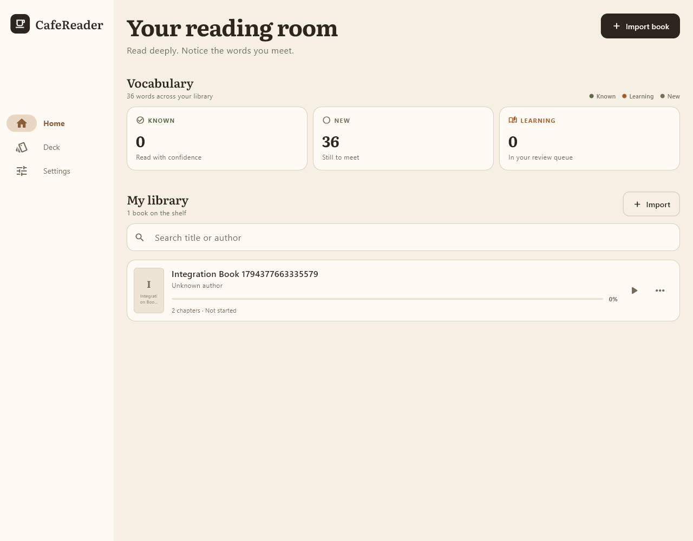 | 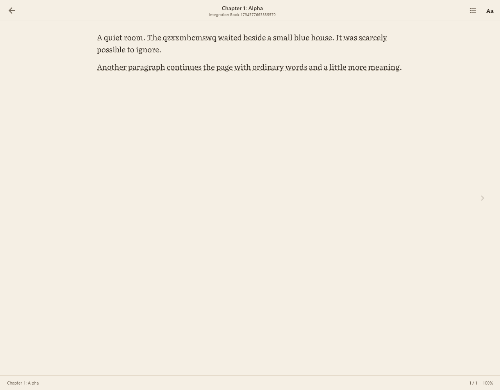 |

| 词汇面板 |  Deck |
|---|---|
| 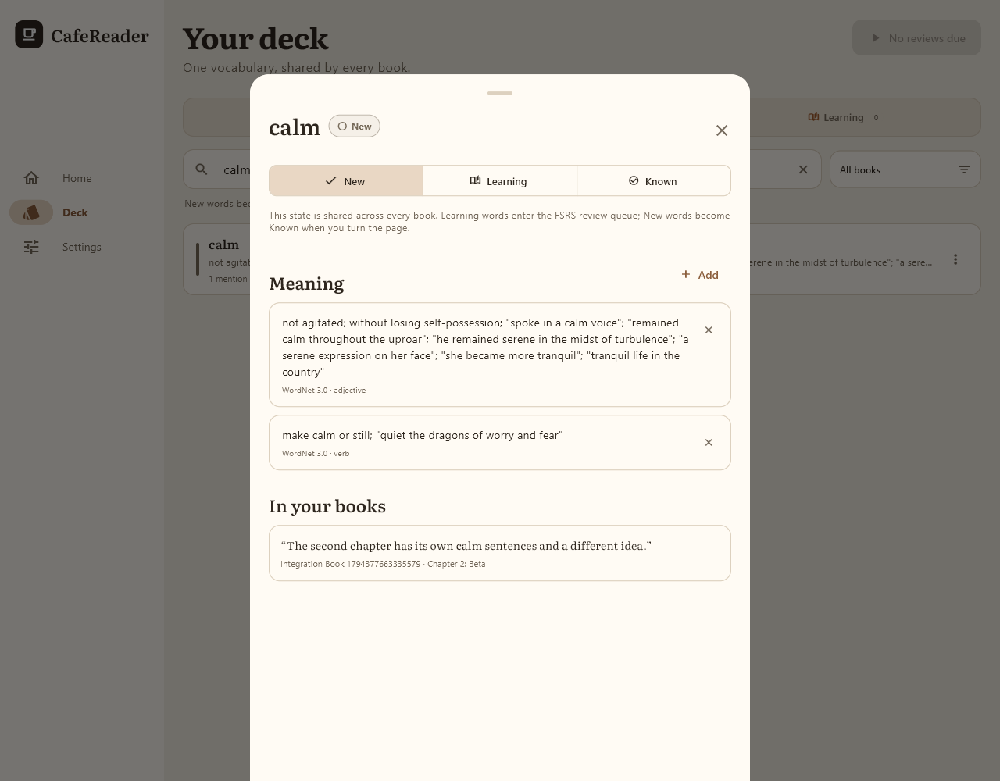 | 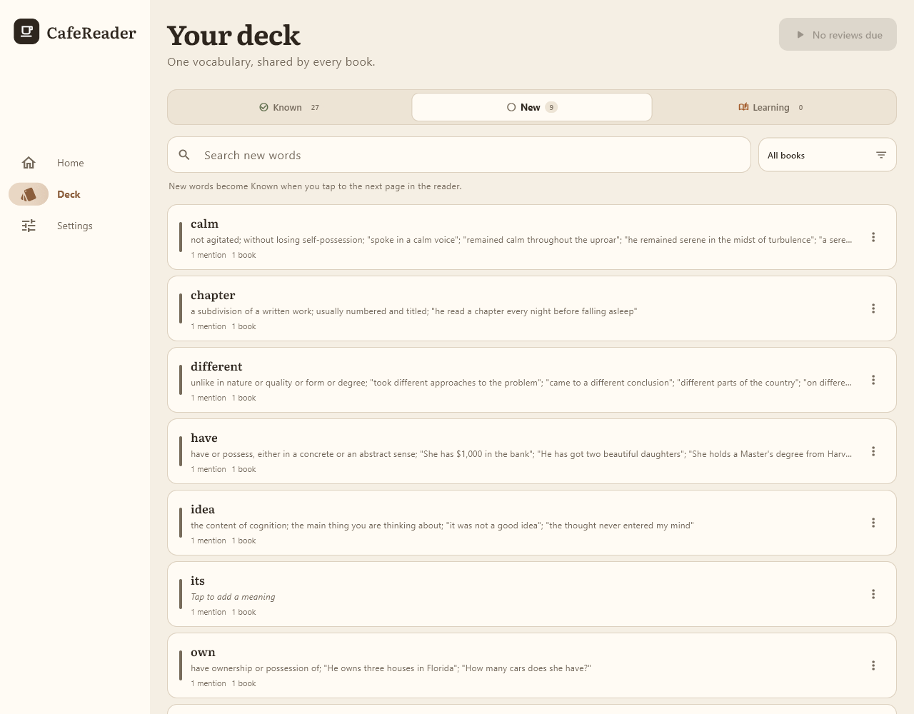 |

| 复习正面 | 复习评分 |
|---|---|
| 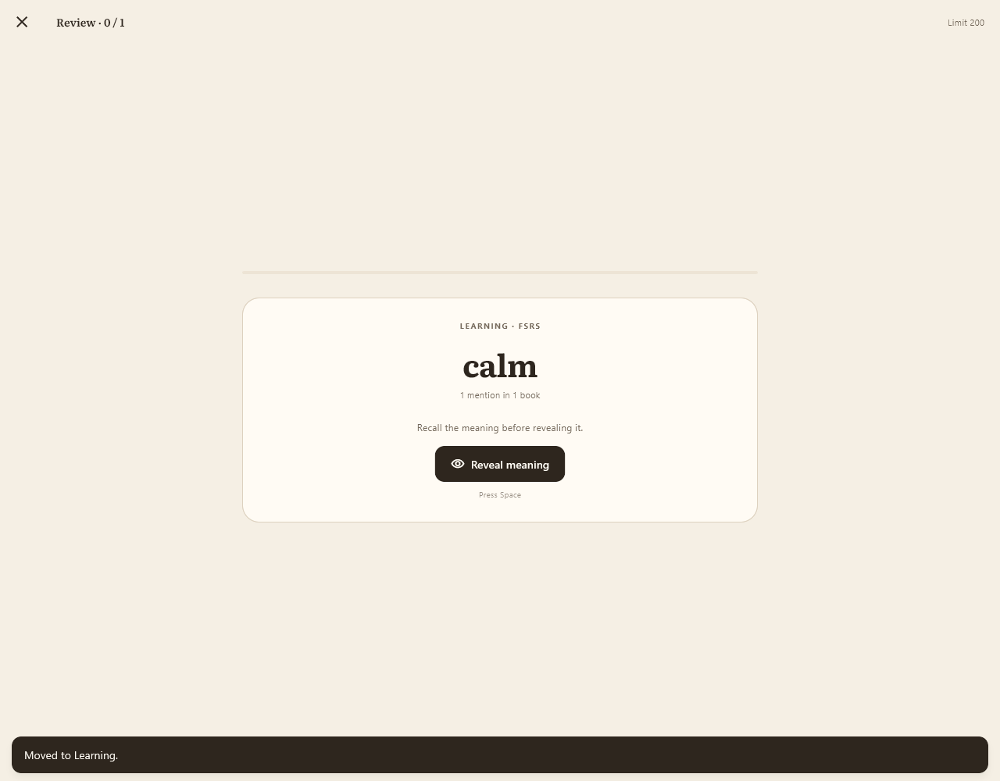 | 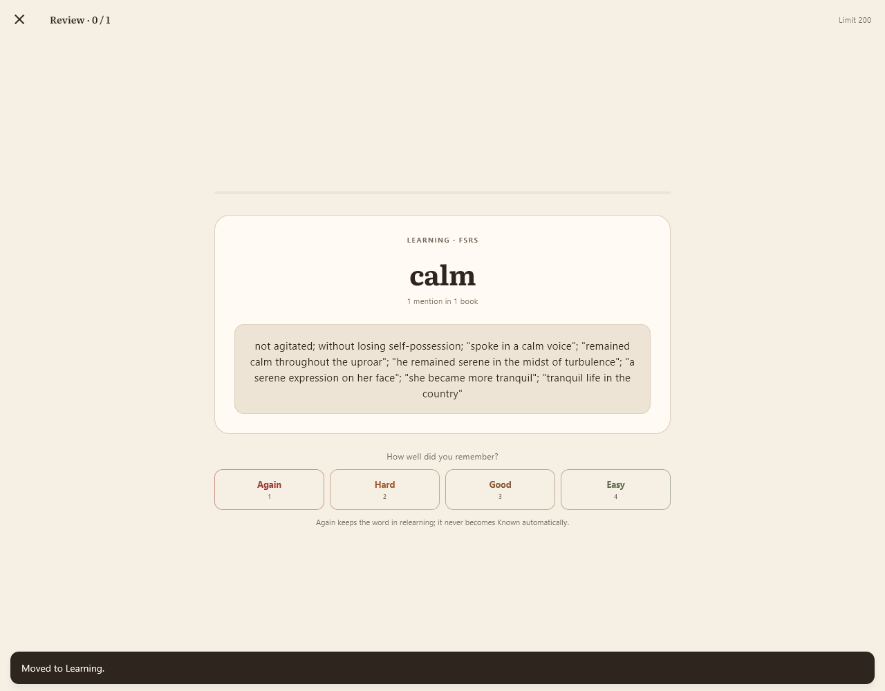 |

| 书籍详情 | Settings |
|---|---|
| 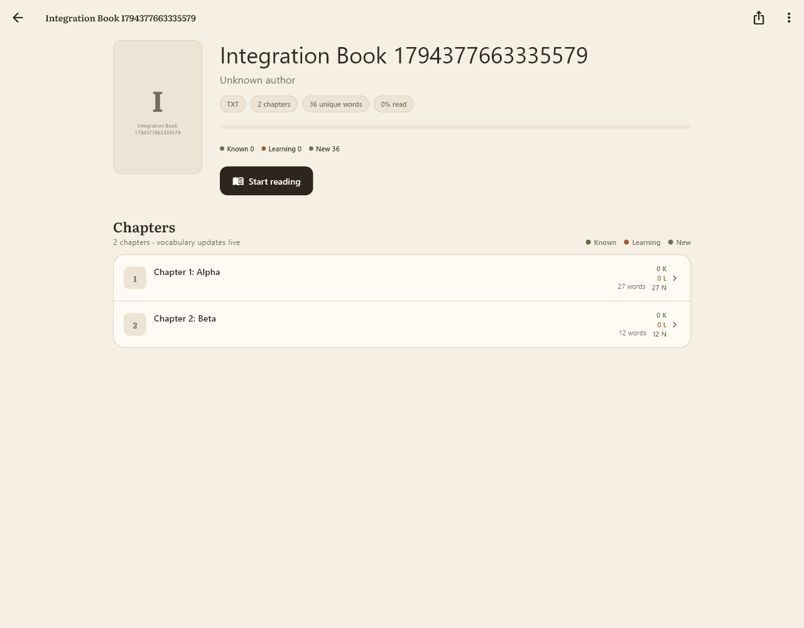 | 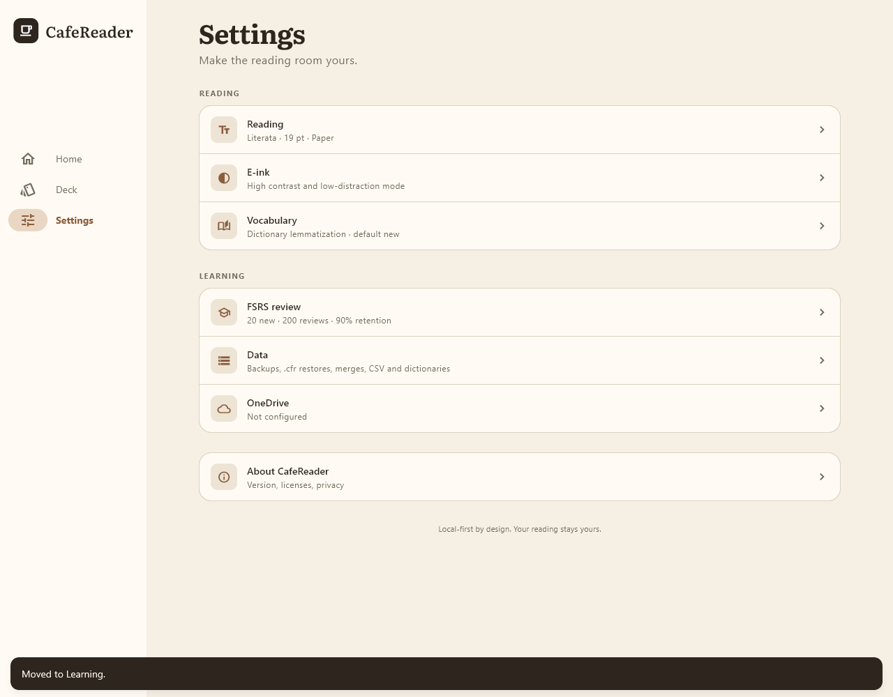 |

| Data | OneDrive |
|---|---|
| 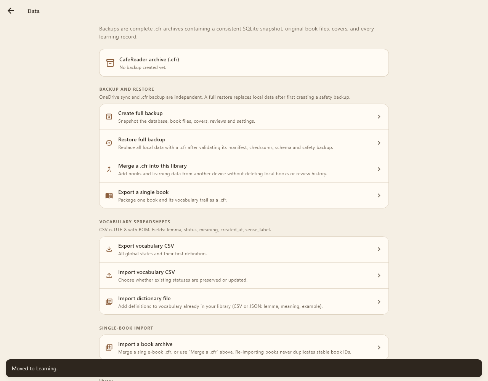 | 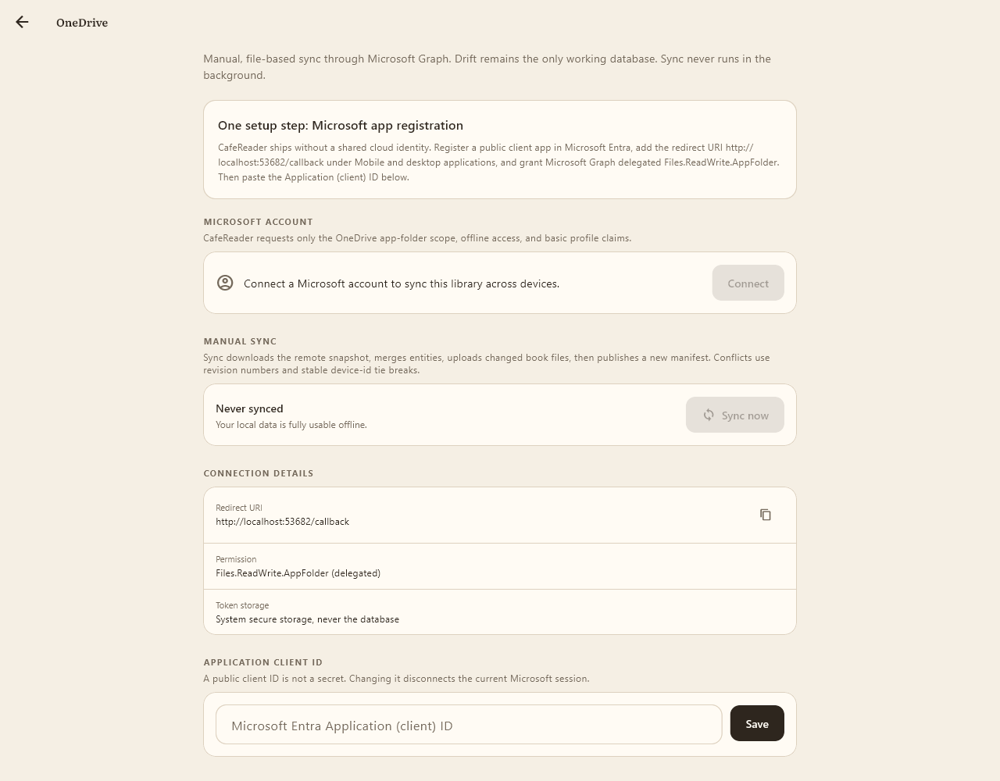 |

| 复习完成 |
|---|
| 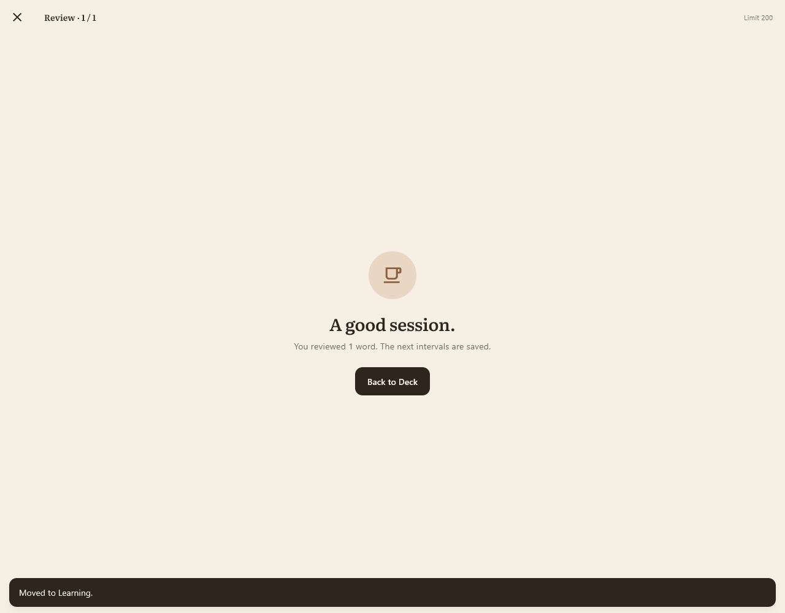 |

更多截图在 [`docs/screenshots/`](docs/screenshots/)。

## 技术栈

| 模块 | 实现 |
|---|---|
| UI | Flutter / Material 3 |
| 状态管理 | Riverpod 2.6 |
| 本地数据库 | Drift + SQLite |
| SQLite | 内置 SQLite 3.46.1 amalgamation，通过 native assets 编译 |
| 阅读字体 | Literata（SIL OFL 1.1） |
| 词典 | WordNet 3.0（Princeton） |
| FSRS | 自实现 FSRS-5 调度器 |
| 同步 | Microsoft Graph / OneDrive App Folder |
| 文件 | `file_picker`, `file_selector`, `share_plus` |
| 安全存储 | `flutter_secure_storage` |

## 目录结构

```text
lib/
├── app/                    # bootstrap、服务容器、Riverpod providers
├── core/
│   ├── backup/             # .cfr 备份、校验、恢复
│   ├── database/           # Drift 表、生成代码、迁移
│   ├── design/             # 主题、公共 UI 组件
│   ├── reader/             # 分页、阅读锚点、排版签名
│   ├── sync/               # 同步引擎与控制器
│   └── util/               # 应用目录
├── data/
│   ├── import_export/      # CSV 与词典导入
│   ├── local/              # 书籍导入、SQLite 快照合并
│   ├── onedrive/           # OAuth PKCE、Graph 客户端
│   └── repository/         # 业务数据访问
├── domain/
│   ├── epub/               # EPUB/TXT 解析
│   ├── fsrs/               # FSRS-5
│   └── lemmatizer/         # tokenizer、词形还原、词典
└── features/               # Home / Reader / Deck / Settings / Sync / ...
```

## 运行

### 环境

- Flutter 3.47.9 / Dart 3.13.7（本项目使用此版本验证）
- Windows 构建需 Visual Studio C++ 工具链
- Android 构建需 Android SDK/NDK

### Windows

```powershell
flutter pub get
dart run build_runner build
flutter run -d windows
```

已在本机成功构建 Release：

```text
build/windows/x64/runner/Release/CafeReader.exe
```

### Android

```powershell
flutter pub get
dart run build_runner build
flutter build apk
```

本次交付按用户要求没有构建 APK；工程代码已通过 `flutter analyze`。

### macOS

macOS 工程已生成（`macos/`），但 Flutter 无法在 Windows 上编译 macOS 目标。请在 macOS 主机上执行：

```bash
flutter pub get
dart run build_runner build
flutter run -d macos
```

已为 macOS 沙盒加入 `network.client`、`network.server`（OAuth loopback）与用户选择文件读写权限。macOS 的 OneDrive token 使用传统 Keychain（关闭 data-protection keychain），因此不强制要求 Keychain Sharing 的 provisioning profile。

### 测试

```powershell
flutter analyze
flutter test
flutter test integration_test/app_test.dart -d windows
```

当前自动化覆盖：

- 词形还原（规则、不规则词、歧义候选）
- 分页与排版变化后的锚点恢复
- 全局词汇状态与“下一页自动 Known”
- 歧义修正的三种范围
- FSRS 调度、复习记录、Learning 状态不被自动提升
- CSV 导入/导出、词典导入
- 快照实体级合并、设备 ID 冲突判定、Known 优先级
- 备份生成/检查/恢复、ZIP Slip 拒绝
- 双设备 OneDrive 同步流程（内存 Graph 假服务）：快照合并、状态 revision 冲突、书籍文件下载/上传、重复同步幂等
- Windows UI 端到端：导入 → 打开阅读器 → 点词 → 翻页自动 Known → Deck → 加入 Learning → 完成一次 FSRS 复习 → Settings / Data / OneDrive

## 数据与文件位置

所有业务数据保存在本地：

- SQLite 数据库：应用支持目录下的 `CafeReader/cafereader.sqlite`
- 原始书籍：`CafeReader/books/`
- 封面：`CafeReader/covers/`
- 备份：`CafeReader/backups/`
- 临时导入/恢复文件：`CafeReader/staging/`

数据库中的业务文件路径保存为相对路径，因此 `.cfr` 和 OneDrive 快照可以在其他设备上恢复。

### 备份格式

```text
CafeReader-....cfr   (ZIP)
├── manifest.json
├── database/
│   └── database.sqlite
├── books/
└── covers/
```

`manifest.json` 包含格式版本、数据库 schema 版本、创建时间、设备 ID、备份类型、文件列表、大小与 SHA-256。

恢复前会校验 manifest、ZIP 结构、文件大小、SHA-256、SQLite schema 与完整性；完整恢复前还会自动在 `backups/` 生成当前数据的安全备份。

## OneDrive 配置

CafeReader 不携带公共的 Microsoft 应用凭据：每个用户/构建需要自己的 Microsoft Entra 公共客户端。

1. 在 Microsoft Entra 管理中心创建应用注册。
2. 支持“个人 Microsoft 账户”（以及需要的组织账户）。
3. 在 **Mobile and desktop applications** 平台添加 Redirect URI：

   ```text
   http://localhost:53682/callback
   ```

4. 添加 Microsoft Graph 委托权限：

   ```text
   Files.ReadWrite.AppFolder
   offline_access
   ```

5. 将 Application (client) ID 粘贴到 CafeReader → Settings → OneDrive。
6. 点击 Connect，完成浏览器授权。
7. 点击 Sync now。

说明：

- 使用 Authorization Code + PKCE；不使用客户端密钥。
- refresh token 仅保存在系统安全存储（Credential Manager / Keychain / Android Keystore），不进入 Drift，不进入备份。
- 使用 `special/approot`（App Folder），只请求应用专属目录权限。
- 同步是手动的；不监听云端变化，不在后台运行。
- 云端只保存快照、Manifest 和书籍文件，不运行数据库服务。
- 当前同步策略：下载远端 SQLite 快照 → 与本地按实体合并 → 增量上传书籍文件 → 上传新快照 → 条件上传 manifest；manifest 的 ETag 冲突会触发重试。

**注意**：由于没有可用的真实 Microsoft 应用注册凭据，本环境未对线上 Graph 进行实际登录/上传验证。认证、Graph 客户端与同步代码均已实现，多设备同步流程已通过内存 Graph 假服务测试（快照合并、文件上传/下载、状态冲突、幂等重复同步）。

## 设计要点

### 全局词汇

```text
word_statuses(vocabulary_id PRIMARY KEY, status, ...)
```

`word_statuses` **没有** `book_id` / `chapter_id`。章节统计每次根据：

```text
COALESCE(word_occurrences.override_vocabulary_id,
         word_occurrences.vocabulary_id)
```

去重后关联全局状态。因此同一个词汇在任意书、章节、Deck、阅读器中状态一致。

### 翻页

`ReaderRepository.commitPageAdvance` 在 Drift transaction 中写入目标页的 Anchored 阅读进度；事务成功后才允许 UI 切换页码。页码翻动不会修改任何词汇状态。

### 分页

`PaginationEngine` 只依赖：

- 文本内容
- `TextStyle`
- 可用宽高
- 段落间距
- `TextScaler`

通过真实 `TextPainter` 测量并用二分查找确定当前页能容纳的字符范围，再退到最近的词边界。分页结果按 `chapter + layout_signature + page_index` 缓存到 `pagination_caches`；恢复位置始终用锚点重新定位，不直接信任旧页码。

### 同步冲突

- 词汇状态 / 阅读进度 / FSRS 卡：`revision` 高者胜；revision 相同时用 `updated_by` 设备 ID 做稳定字典序 tie-break。
- 书籍元数据：revision 高者胜；删除通过 tombstone 传播。
- 复习记录：按稳定 id 求并集，不因合并丢失。
- 书籍文件：稳定 `book_id` + SHA-256；上传会话支持大文件。

## 已知限制

- **Web 不是支持目标**：Drift 原生 SQLite、文件系统和 OAuth loopback 均依赖桌面/移动运行时。未实现 Web 数据层。
- **OneDrive 未做真实账户联调**：需要用户自己的 Entra 应用；Graph 行为可能随租户策略不同。
- **macOS 未在本机编译**：工程和沙盒权限已配置，需在 macOS 验证。
- **Android 未构建 APK**：按本次要求跳过；代码已静态分析。
- 完整恢复从 ZIP 提取时按单个文件读取内容，超大书籍会占用较多内存；数据库快照本身使用 SQLite `VACUUM INTO` 保证一致性。
- 合并导入采用确定性规则，不提供逐条冲突 UI；极端并发下仍可能有 last-tie-break 选择的语义差异。
- 词典释义来自 WordNet 按 SemCor 词频排序的前几个义项，面向阅读辅助，不替代完整学习词典。
- 未实现撤销操作；词汇状态修改即时保存。

## 第三方资源

- **WordNet 3.0**，Princeton University。许可证见
  [`assets/dictionary/WORDNET_LICENSE.txt`](assets/dictionary/WORDNET_LICENSE.txt)。
  词元与 gloss 资源由 [`tool/build_wordnet_assets.py`](tool/build_wordnet_assets.py)
  从 WordNet 数据生成，运行时完全离线。
- **Literata**，SIL Open Font License 1.1。许可证见
  [`assets/fonts/OFL.txt`](assets/fonts/OFL.txt)。
- **SQLite 3.46.1**，public domain。说明见
  [`third_party/sqlite/README.md`](third_party/sqlite/README.md)。
- Flutter/Dart 依赖的许可证可通过应用内 About → Third-party licenses 查看。

## 隐私

- 无注册、无分析、无广告、无自建服务器。
- 书籍、词汇、定义和复习历史只存在本地 SQLite 中。
- Microsoft refresh token 只存在操作系统安全存储中，不写入数据库、日志或 `.cfr`。
- 只有用户点击 Sync now 时才会访问 OneDrive。

## License

本应用代码的许可证尚未由项目所有者指定。第三方组件遵循各自许可证。
